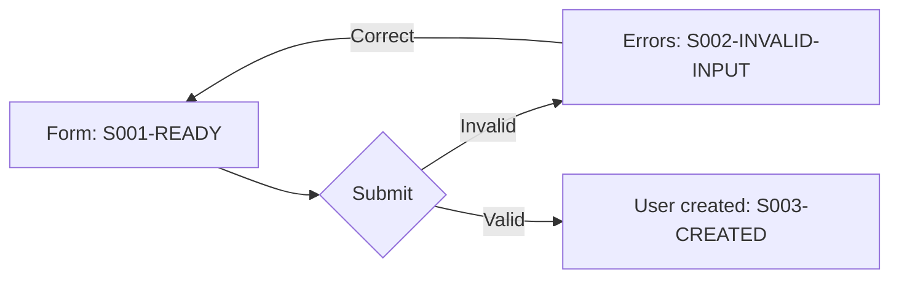

# User-flow evidence

Use one record per capability, splitting only when branches become hard to follow.
Discover from navigation, routes, authorization, documents, tests and observed use;
do not let a written feature list hide other reachable paths. Enumerate relevant
actor/role variants, cross-role handoffs and meaningful input classes. Include denied,
empty, invalid, loading, error/recovery, cancellation, repeated submission and completed
states where they exist. State the scope; do not claim all input permutations were tested.

| Field | Compact record |
| --- | --- |
| Identity | Full flow ID, actor, goal, source references |
| Start | Entry point, authorization, synthetic fixture/preconditions |
| Steps | User action → visible state → meaningful backend result |
| Branches | Condition → state/outcome/recovery; stable state IDs |
| Contract | Preserved invariant or linked defect/improvement criterion |
| Evidence | Scenario/test links, actual screenshots, correlated I/O, proof status |

Capture actual browser states with synthetic data. Embed screenshots next to their
step/branch; include enough context to understand the result and next action. Identify
snapshot, role, fixture, locale and viewport in the manifest or record. Use representative
desktop/mobile layouts; add tablet/theme/locale variants when behavior differs. Reuse
automated scenario captures rather than repeating the same journey solely for images.
Inspect captures for legibility and the claimed state; file existence is not proof.

Correlate requests, persistence and async completion to the same scenario, or record
that a client-side step made no request. Screenshots prove appearance, not backend
correctness. Link focused output/assertions rather than dumping logs or sensitive
payloads. Missing browser access leaves visual evidence blocked, never inferred green.

Use Mermaid flow/state diagrams for branches and sequence diagrams for component
handoffs. Label source-derived edges versus executed paths. Store one canonical diagram
and link it; verify rendering where possible and mark it unverified otherwise.

Illustrative flow `F001-ADD-USERS`:

For later comparison, use equivalent synthetic cases and capture states at comparable
viewports. Compare task completion, clarity, validation and recovery as well as appearance.
A changed pixel or a cleaner layout alone does not demonstrate improved behavior.
