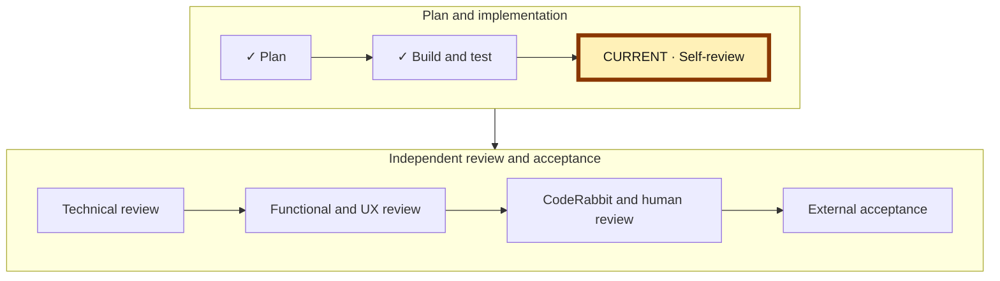

# Develop a feature

Initialize or resume the [local feature workspace](../../references/feature-workspace.md) at intake. Carry its pinned versions through planning, implementation, independent reviews and acceptance.

Start at the first unfinished step. Keep the agreed request, reviewed revision,
evidence and outstanding decisions in the conversation or existing work item.
The full workflow uses the separately installed Feedback Triage plugin for steps
5 and 6. If its skills are unavailable, identify the pending step.
The developer can exercise any available increment at any time.

1. **Plan.** Use [plan-feature](../plan-feature/SKILL.md) to agree the numbered requirements and complexity,
   confirm the Mermaid flow and runnable prototype with the user, then obtain
   an independent pass on the database and file plan before building.
2. **Build and test.** Use [build-and-test](../build-and-test/SKILL.md) with the
   project guidelines and applicable framework skills. For behavior-preserving
   restructuring use [refactor](../refactor/SKILL.md).
3. **Review your own changes.** The implementer runs [self-review](../self-review/SKILL.md),
   fixes omissions and reruns affected checks before handing off the candidate.
4. **Technical peer review.** Run [technical-review](../technical-review/SKILL.md)
   on the implementation. Resolve blocking findings and obtain the independent
   recheck on any corrections before starting UX validation.
5. **Functional and UX validation.** Use `feedback-triage:validate-original-request`
   with the original issue or confirmed conversation brief and current tree.
   Preserve its independent roles and evidence requirements. Exercise normal,
   error and recovery journeys and inspect actual screens for visual changes.
   For accepted findings, revisit build, self-review and independent technical
   review on the affected changes, then revalidate the corrected candidate.
6. **CodeRabbit and human code review.** Use the project's commit and pre-push
   checks for an authorized PR/MR. Obtain CodeRabbit's review and a human peer
   review. Track each separately against the submitted revision. Process both
   sources with `feedback-triage:process-pr-feedback`. Record
   the outcome of each claim. For fixes, return to steps 2 through 5 for the
   affected changes. Obtain current CodeRabbit and human review outcomes for
   the resulting candidate. A paused bot, an empty inbox or a missing human
   verdict leaves that review pending. Request reviews or post externally only
   within the user's authorization.
7. **External user acceptance.** Use [user-acceptance](../user-acceptance/SKILL.md)
   to prepare the reviewed candidate and record the external user's decision.
   Acceptance completes the workflow. Return defects to implementation and
   changed requirements to planning.

## Guide the requester at each handoff

At intake, on resume and at every stage transition, send the requester a status
update in chat. Include a fenced Mermaid diagram of the full workflow in two rows. Read each row
from left to right, then continue on the second row. Label completed stages and mark the current one in words, including
the current planning substep when applicable. Mark a blocked or waiting stage
explicitly. Translate the labels to the requester’s language.

Use two LR subgraphs in a TB flowchart and connect the subgraphs themselves
so Mermaid preserves each row's direction. Use a thick solid border, a
contrasting fill and the word “current” on exactly one stage. Move the style
with the label at each transition. At completion mark external acceptance done.

Example immediately after the builder has verified the change:

Report the build result, builder’s self-review, independent technical review
and functional/UX review **as four distinct chat updates**, even when one
agent session or a delegated task handles multiple stages. Publish each result
before moving on. Each update states what was checked on which candidate,
the observed result (including open findings), and what is current now.
For example, a passing build reports its test results and highlights self-review
as current. A review requesting fixes reports the finding and highlights the
stage that owns the fix. Mark affected later verdicts as awaiting recheck when
the candidate changes. Keep the current stage and latest evidence in the
feature README so a resumed session can reconstruct the diagram. On explicit
external acceptance mark the workflow complete.

End each step update, including each of the three planning steps, with one short
**Suggested next step** in the requester's language. Name who acts and what they
should do with the current result. For example, ask the requester to confirm
requirement 1.2 or try the approval scenario in the prototype. When the next
action belongs to the agent and is authorized, state it and continue. When a test
fails or a review requests changes, suggest the concrete correction and recheck.
After external acceptance, record completion as the final outcome.

## When Superpowers executes the plan

Keep the following assignments in the executable plan, including when
`superpowers:writing-plans` prepares it. A fresh agent may only see its task
brief. Pass the specific installed skill names, or their readable SKILL.md
paths, and ask the assigned agent to open and apply them. If it lacks a required
skill, identify the missing step before crediting it as complete.

- **Implementer.** With `superpowers:executing-plans`, the current session
  writes and tests the code. With `superpowers:subagent-driven-development`,
  put the same instructions in each implementer's dispatch. Include agreed
  IDs and outcomes, owned paths, project rules, `development:build-and-test`,
  the applicable framework implementation/testing skills and
  `development:self-review`. Ask for the actual diff, test commands and
  observed results, plus fixes and outstanding findings from self-review.
- **Independent reviewer.** In delegated execution, give each task reviewer the
  relevant IDs, diff and framework review guidance for its slice. When dispatching
  a whole-change reviewer via
  `superpowers:requesting-code-review`, assign the reviewer procedure in
  `development:technical-review` directly to that fresh reviewer. Include
  original requirements, base/head and working-tree changes, applicable
  framework review skills and run instructions. The reviewer inspects the
  candidate and returns findings and a verdict. One independent review can
  satisfy both workflows when it covers the whole candidate and both contracts.
- **Coordinator.** Verify the returned evidence, send necessary fixes to the
  builder and have the affected review repeated. After technical approval,
  continue with functional/UX validation, CodeRabbit and human review,
  feedback processing and external acceptance in steps 5–7.
